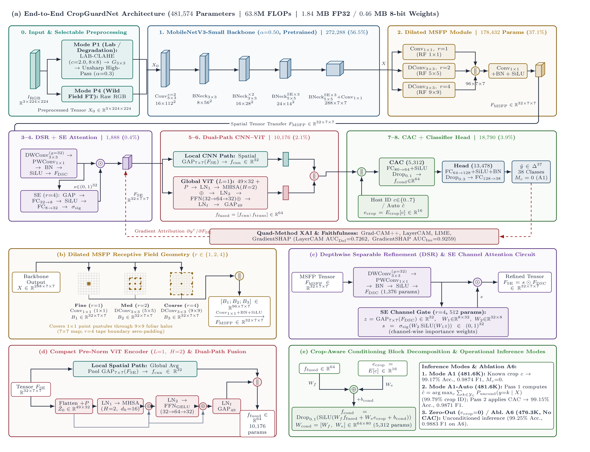
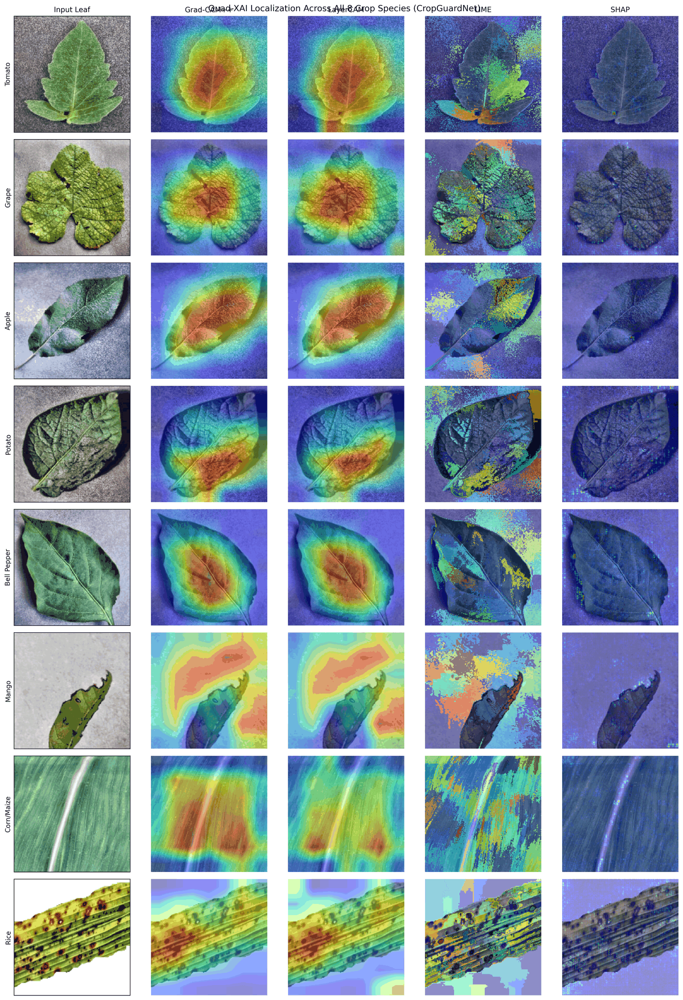

# CropGuardNet

**Official Implementation: Leak-Free Cross-Crop Leaf Disease Detection with Multi-Scale Attention and Four-Family Explainable AI**

[](https://saaillab.github.io/CropGuardNet/)
[](https://saaillab.github.io/papers/cropguardnet/)
[](https://saaillab.github.io/papers/cropguardnet/)
[](LICENSE)



---

## Abstract Summary

Crop diseases threaten global and smallholder food security, yet deep detectors remain overwhelmingly single-crop, heavyweight, or opaque for constrained field deployment. **CropGuardNet** unifies a lightweight convolutional backbone with a compact two-head Transformer encoder and learnable species conditioning across **481,574 trainable parameters** (**1.84 MB** FP32 weights, **63.8M FLOPs**, **5.00 ms / 200.0 FPS** single-thread CPU ONNX Runtime latency). Evaluated on **35,420 deduplicated leaf images** spanning **8 crops and 38 classes** after purging **80,238 offline-augmented duplicate copies**, CropGuardNet attains **99.17% accuracy**, **0.9874 F1-macro**, **0.9914 MCC**, and **0.9998 AUC-ROC**.

---

## Multi-Crop Explainable AI Attribution



Four complementary explainable AI families (Grad-CAM++, LayerCAM, LIME, and GradientSHAP) audited under 20-step Deletion and Insertion faithfulness against a blurred baseline demonstrate crisp lesion localization across Tomato, Grape, Apple, Potato, Pepper, Mango, Corn/Maize, and Rice.

| XAI Family | Attribution Mechanism | Deletion AUC (↓) | Insertion AUC (↑) |
|---|---|---:|---:|
| **LayerCAM** | Element-wise multi-scale spatial gradients | **0.7262 ± 0.2705** | 0.9181 ± 0.1175 |
| **Grad-CAM++** | Higher-order positive gradient weights | 0.7289 ± 0.2643 | 0.9214 ± 0.1141 |
| **GradientSHAP** | Game-theoretic integrated path expectations | 0.7446 ± 0.2515 | **0.9259 ± 0.1013** |
| **LIME** | SLIC superpixel local surrogate regression | 0.8492 ± 0.1782 | 0.9039 ± 0.1386 |

---

## Primary 38-Class Benchmark Results (`n = 5,314` Held-Out Test Images)

| Model | Params | Size (MB) | FLOPs (M) | Accuracy (%) | F1-Macro | MCC | CPU Latency (ms) |
|---|---:|---:|---:|---:|---:|---:|---:|
| VGG-16 | 134,416,230 | 512.76 | 30,932.6 | 97.95 | 0.9703 | 0.9787 | 414.72 ± 17.82 |
| ResNet-50 | 23,585,894 | 89.97 | 8,174.4 | 99.13 | 0.9751 | 0.9910 | 78.03 ± 2.38 |
| MangoXNet | 4,426,374 | 16.89 | 273.8 | 99.15 | 0.9746 | 0.9912 | 16.36 ± 0.75 |
| EfficientNet-B0 | 4,056,226 | 15.47 | 769.2 | 99.21 | 0.9834 | 0.9918 | 30.79 ± 1.78 |
| MobileNetV3-Small | 1,556,806 | 5.94 | 111.1 | 99.23 | 0.9740 | 0.9920 | 11.38 ± 0.53 |
| LeafXNet | 79,782 | 0.30 | 1,156.6 | 97.27 | 0.9558 | 0.9717 | 22.64 ± 0.55 |
| **CropGuardNet (Ours)** | **481,574** | **1.84** | **63.8** | **99.17** | **0.9874** | **0.9914** | **11.49 PyTorch / 5.00 ONNX** |

---

## Robustness, Cross-Crop Probing & External Field Transfer

- **20-Regime Synthetic Corruptions:** Leads all evaluated models with **83.61% mean accuracy** (`p = 0.0020` Wilcoxon signed-rank test under severe perturbations versus LeafXNet).
- **8-Fold Leave-One-Crop-Out (LOCO) Probing (`n = 7,072`):** Achieves **81.22% accuracy** and **0.8879 binary AUC-ROC** on unseen held-out crop families.
- **Crop Conditioning & Auto-Routing:** Eliminates cross-crop false positives (`Mc = 0`) under guided inference and sustains **99.79% automatic crop routing accuracy** (Mode A1-Auto) and lifts minority Rice accuracy to **94.44%**.
- **PlantDoc External Field Benchmark:** Guided Mode A1 yields **40.63%–45.91% zero-shot accuracy** (versus 16.06%–17.58% unguided), rising to **62.20% Enhanced** and **63.66% Raw RGB** after 20-epoch adaptation.

---

## Architectural Decomposition (481,574 Parameters)

| Stage / Module | Configuration | Output Tensor | Trainable Params | Share |
|---|---|---|---:|---:|
| 1. Stem Backbone | MobileNetV3-Small (`alpha = 0.50`, stride 32) | `B x 288 x 7 x 7` | 272,288 | 56.54% |
| 2. MSFP Pyramid | Parallel dilated branches (`1x1`, `3x3 r=2`, `3x3 r=4`) + fuse | `B x 32 x 7 x 7` | 178,432 | 37.05% |
| 3. DSR Refinement | Depthwise `3x3` (288) + pointwise `1x1` (1,024) + SiLU | `B x 32 x 7 x 7` | 1,376 | 0.29% |
| 4. SE Recalibration | Global average pool + `32 -> 8 -> 32` gating | `B x 32 x 7 x 7` | 512 | 0.11% |
| 5. Compact ViT | Learned PosEmbed + 1-layer 2-head MHSA + FFN | `B x 32 x 7 x 7` | 10,176 | 2.11% |
| 6. Dual-Path Fusion | Concatenated `GAP(F_SE) || GAP(F_Trans)` | `B x 64` | 0 | 0.00% |
| 7. Crop Conditioning | `Embedding(8 x 16)` + `Linear(80 -> 64)` + SiLU | `B x 64` | 5,312 | 1.10% |
| 8. Classifier Head | `Linear(64 -> 128 -> 38)` with BN & Dropout | `B x 38` | 13,478 | 2.80% |

---

## Repository Structure

```text
CropGuardNet/
├── config.py                 # Model, dataset, preprocessing, and hyperparameter configuration
├── main.py                   # CLI entry point (train / eval / ablation / multi-seed)
├── download_datasets.py      # Dataset download helper (upstream licenses apply)
├── requirements.txt
├── src/
│   ├── __init__.py
│   ├── models.py             # CropGuardNet, MSFP, DSR, SE, Compact ViT, Crop Conditioning
│   ├── dataset.py            # Multi-crop dataloader, stratified 70/15/15 splits, CLAHE & Gaussian filtering
│   ├── train.py              # Training loop & multi-seed orchestration
│   ├── evaluate.py           # Classification, calibration, efficiency, and ONNX latency suites
│   ├── xai.py                # Grad-CAM++, LayerCAM, LIME, GradientSHAP & faithfulness curves
│   └── robustness.py         # 20-regime corruptions, LOCO probing & PlantDoc field eval
├── results/
│   ├── classification_report.txt
│   └── dataset_info.json     # 35,420-image UUID & 64-bit pHash deduplicated manifest (80,238 duplicates purged)
├── figures/
│   ├── architecture.png
│   ├── fig_calibration_bootstrap.png
│   ├── fig_crosscrop_loco.png
│   └── fig_xai_master_8crops.png
└── docs/                     # Standalone project website (saaillab.github.io/CropGuardNet/)
```

---

## Reproducible Usage

```bash
git clone https://github.com/saaillab/CropGuardNet.git
cd CropGuardNet
pip install -r requirements.txt

# 1. Fetch source datasets into data/raw/
python download_datasets.py

# 2. Train CropGuardNet (seed 42)
python main.py --mode train --model cropguardnet
```

> **Note on Raw Imagery & Heavy Checkpoints:** Raw third-party `.jpg` images across all 35,420 samples and large comparison baselines (`VGG-16`, `ResNet-50`) are omitted from git history to respect upstream licenses and repository storage constraints.

---

## Citation

```bibtex
@misc{nyalala2026cropguardnet,
  title={CropGuardNet: A Unified Lightweight CNN-Transformer Framework with Multi-Scale Attention and Explainable AI for Cross-Crop Leaf Disease Detection},
  author={Nyalala, Innocent},
  howpublished={Manuscript Under Peer Review (SAAIL Lab)},
  year={2026},
  url={https://saaillab.github.io/papers/cropguardnet/}
}
```

---

## License

&copy; 2026 Innocent Nyalala & SAAIL Lab, Indian Institute of Technology Madras Zanzibar. Released under [CC BY-NC 4.0](LICENSE).


Maintained by **[SAAIL Lab](https://saaillab.github.io/)** · School of Engineering and Science, Indian Institute of Technology Madras Zanzibar · PI: **[Innocent Nyalala](https://www.iitmz.ac.in/schools/engineering-and-science/faculty/prof-innocent-nyalala)**.
